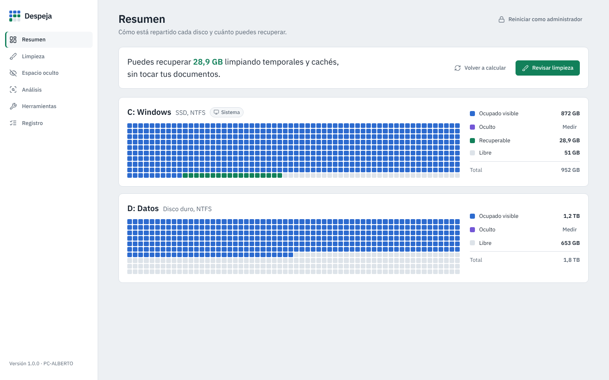

<p align="center"></p>

# Despeja

[Español](README.md) · **English**

Cleans and audits the **visible and hidden** space on your Windows 10/11 drives. It shows each drive as a sector map, works out how much space you can recover, safely cleans temporary files and caches, and reveals what takes up space without showing in File Explorer: hibernation, virtual memory, restore points, WinSxS, Windows.old…

Built following a **secure software development lifecycle** ([docs/SDLC.md](docs/SDLC.md)), with a STRIDE threat model ([docs/MODELO_AMENAZAS.md](docs/MODELO_AMENAZAS.md)). The app interface and the SDLC documents are in Spanish.



## What it does
| Section | Purpose |
|---|---|
| **Resumen** (Overview) | Sector map of each drive (visible, hidden, recoverable and free) and how much you can recover without touching your documents. |
| **Limpieza** (Cleanup) | About 35 items in 6 groups: Windows (temp files, Windows Update, memory dumps, logs, thumbnails, DirectX…), browsers (Chrome, Edge, Brave, Opera, Firefox), apps (Teams, Discord, Slack, Spotify, VS Code, Steam), graphics (NVIDIA/AMD caches and installers), development (pip, npm, NuGet, Gradle, Hugging Face) and old downloads. **Simulate** before cleaning. |
| **Espacio oculto** (Hidden space) | hiberfil.sys, pagefile.sys, swapfile.sys, Recycle Bin, restore points, WinSxS, Installer, Windows.old and Windows Update, each with what you can do about it. |
| **Análisis** (Analysis) | A drive or folder: visible vs hidden, inaccessible or reserved space, cloud-only files, folders, file types and the 60 largest files (sent to the Recycle Bin in one click). |
| **Herramientas** (Tools) | Component cleanup with DISM, hibernation, System Protection, Storage settings and **secure free-space wipe** (`cipher /w`). |
| **Registro** (Log) | Every operation with date, user and bytes, in a verifiable SHA-256 hash chain. Export to HTML or CSV. |

## Security
- **Never deletes outside a closed list** of known folders. The interface cannot ask for an arbitrary path to be deleted.
- **Does not follow junctions or symbolic links**, and protects critical paths (Windows, Program Files, user profile, Documents, OneDrive…).
- **Never touches cloud-only OneDrive files.**
- Temp files are only removed after 24 h; files in use are skipped.
- Downloads and large files go to the **Recycle Bin**, never straight to deletion.
- **Starts without administrator rights** and only elevates when you ask.
- **No network, no telemetry**: the interface is loaded in memory with a strict CSP.
- Full details: [docs/SDLC.md](docs/SDLC.md) · Vulnerabilities: [SECURITY.md](SECURITY.md).

## Installation (build on Windows)
1. Install **64-bit Python 3.12** from python.org (tick *Add python.exe to PATH*).
2. Double-click **`build_exe.bat`**. It runs the tests, bandit and pip-audit, builds `dist\Despeja\Despeja.exe`, tests it and writes `SHA256SUMS.txt`.
3. For system items: right-click `Despeja.exe` ▸ *Run as administrator*, or use the button inside the app.

Requires **Microsoft Edge WebView2 Runtime** (included with Windows 11).

## Development
```
python -m venv .venv && .venv\Scripts\activate
pip install -r requirements-dev.txt
python app.py                  # open the app
python -m pytest tests         # tests
python -m bandit -r despeja app.py -ll
python -m pip_audit -r requirements.txt
```
`ui/demo.js` holds sample data to review the interface in a browser; it is not included in the executable.

## License
MIT. [Lucide](https://lucide.dev) icons (ISC) and the IBM Plex Sans typeface (OFL): see [THIRD_PARTY_NOTICES.md](THIRD_PARTY_NOTICES.md).

Author: Alberto
