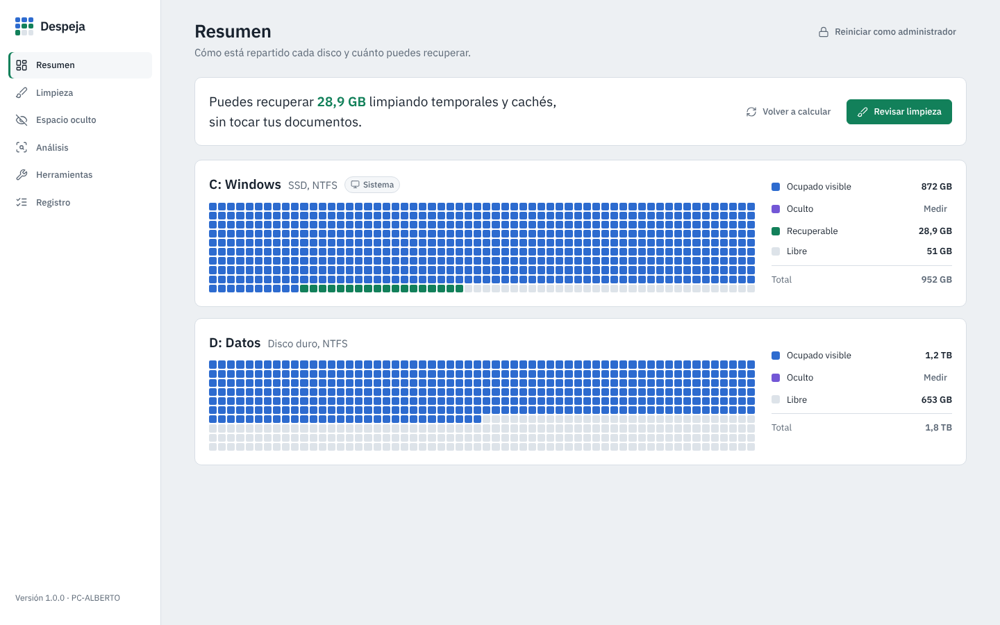

<p align="center"></p>

# Despeja

**Español** · [English](README.en.md)

Limpieza y auditoría del espacio **visible y oculto** de los discos en Windows 10/11. Muestra cada disco como un mapa de sectores, calcula cuánto puedes recuperar, limpia temporales y cachés de forma segura y te enseña lo que ocupa sitio sin verse: hibernación, memoria virtual, puntos de restauración, WinSxS, Windows.old…

Desarrollada siguiendo un **ciclo de vida de desarrollo seguro** ([docs/SDLC.md](docs/SDLC.md)), con modelo de amenazas STRIDE ([docs/MODELO_AMENAZAS.md](docs/MODELO_AMENAZAS.md)).



## Qué hace
| Sección | Para qué |
|---|---|
| **Resumen** | Mapa de sectores de cada unidad (visible, oculto, recuperable y libre) y cuánto puedes recuperar sin tocar tus documentos. |
| **Limpieza** | Unos 35 elementos en 6 grupos: Windows (temporales, Windows Update, volcados, registros, miniaturas, DirectX…), navegadores (Chrome, Edge, Brave, Opera, Firefox), aplicaciones (Teams, Discord, Slack, Spotify, VS Code, Steam), gráficos (cachés e instaladores de NVIDIA/AMD), desarrollo (pip, npm, NuGet, Gradle, Hugging Face) y descargas antiguas. **Simular** antes de limpiar. |
| **Espacio oculto** | hiberfil.sys, pagefile.sys, swapfile.sys, papelera, puntos de restauración, WinSxS, Installer, Windows.old y Windows Update, cada uno con lo que se puede hacer. |
| **Análisis** | Una unidad o carpeta: visible frente a oculto, espacio sin acceso o reservado, archivos solo en la nube, carpetas, tipos y los 60 archivos más grandes (a la papelera con un clic). |
| **Herramientas** | Limpieza de componentes con DISM, hibernación, Protección del sistema, Configuración de almacenamiento y **borrado seguro del espacio libre** (`cipher /w`). |
| **Registro** | Cada operación con fecha, usuario y bytes, en una cadena de hashes SHA-256 verificable. Exporta a HTML o CSV. |

## Seguridad
- **Nunca borra fuera de una lista cerrada** de carpetas conocidas. La interfaz no puede pedir que se borre una ruta.
- **No sigue uniones ni enlaces simbólicos**, y protege rutas críticas (Windows, Program Files, perfil, Documentos, OneDrive…).
- **No toca archivos de OneDrive** que solo están en la nube.
- Temporales solo con más de 24 h; los archivos en uso se saltan.
- Descargas y archivos grandes van a la **papelera**, no se borran directamente.
- **Arranca sin administrador** y solo se eleva si lo pides.
- **Sin red ni telemetría**: la interfaz se carga en memoria con una CSP estricta.
- Detalle completo: [docs/SDLC.md](docs/SDLC.md) · Vulnerabilidades: [SECURITY.md](SECURITY.md).

## Instalación (compilar en Windows)
1. Instala **Python 3.12 de 64 bits** desde python.org (marca *Add python.exe to PATH*).
2. Doble clic en **`build_exe.bat`**. Pasa pruebas, bandit y pip-audit, compila `dist\Despeja\Despeja.exe`, lo prueba y genera `SHA256SUMS.txt`.
3. Para las partes de sistema: clic derecho en `Despeja.exe` ▸ *Ejecutar como administrador*, o el botón de la app.

Necesita **Microsoft Edge WebView2 Runtime** (viene con Windows 11).

## Desarrollo
```
python -m venv .venv && .venv\Scripts\activate
pip install -r requirements-dev.txt
python app.py                  # abre la app
python -m pytest tests         # pruebas
python -m bandit -r despeja app.py -ll
python -m pip_audit -r requirements.txt
```
`ui/demo.js` contiene datos de ejemplo para revisar la interfaz en un navegador; no se incluye en el ejecutable.

## Licencia
MIT. Iconos [Lucide](https://lucide.dev) (ISC) y tipografía IBM Plex Sans (OFL): ver [THIRD_PARTY_NOTICES.md](THIRD_PARTY_NOTICES.md).

Autor: Alberto
